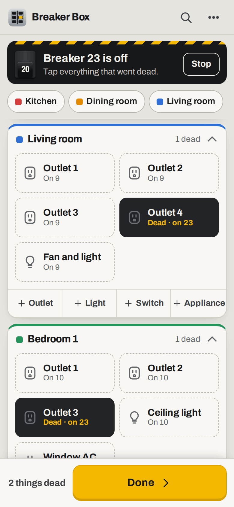
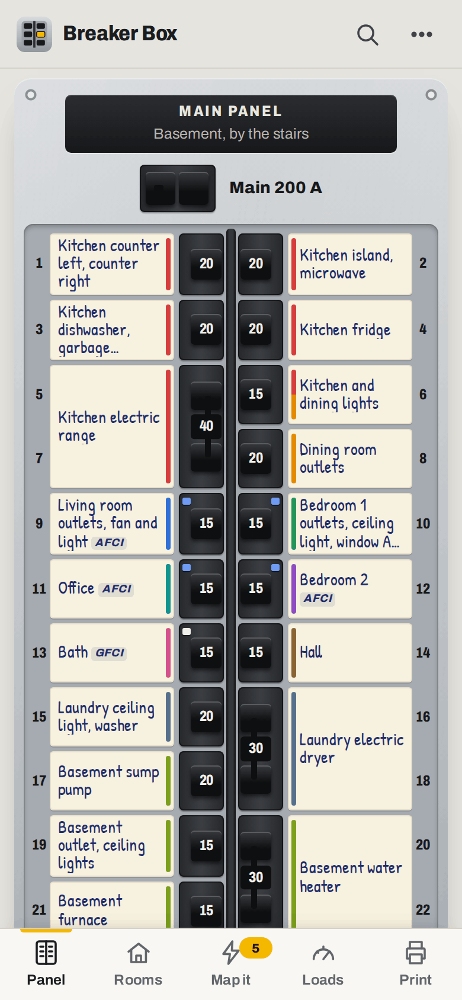
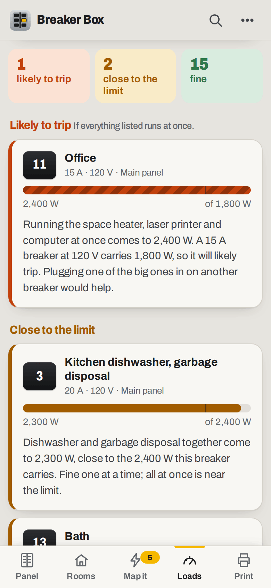
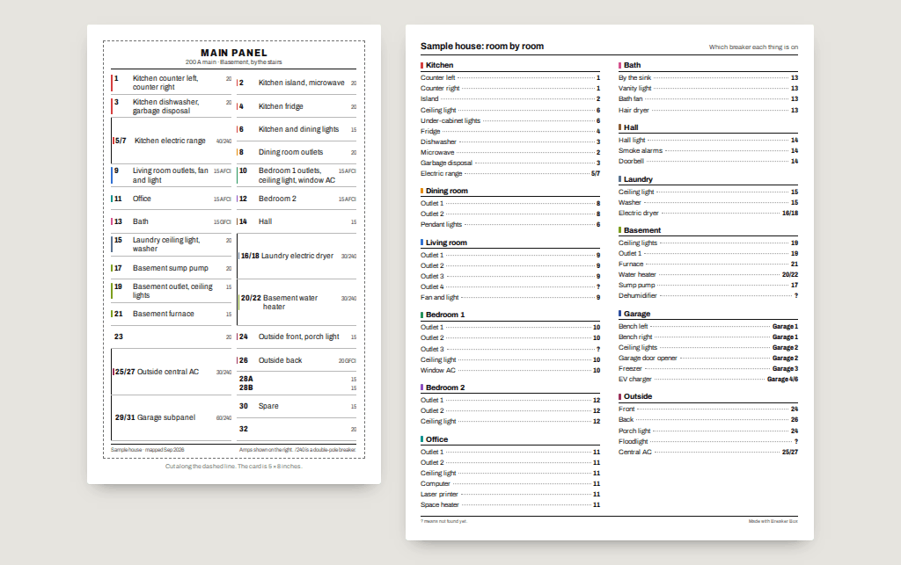

# Breaker Box

**Use it: [junkdrawer.works/breaker-box](https://junkdrawer.works/breaker-box/)**

**Map your breaker panel, one breaker at a time.** Flip a breaker off, walk round the house and tap everything that went dead, and Breaker Box builds the map as you go. It shows the panel the way it looks with the door open, checks what's on each circuit against the breaker, and prints a directory sized for the panel door.

<p align="center">
  
  &nbsp;
  
  &nbsp;
  
</p>

<p align="center">
  
</p>

<sub>Screenshots use the sample house.</sub>

## How it works

- **Set up the panel.** Say how many spaces it has and the size of the main breaker, and it starts with a 15 A breaker in every space, numbered the usual US way: odd numbers down the left, even down the right. Tap a breaker to change its size, make it double-pole (240 V, taking the space below it too, like a dryer or a range), tandem (two circuits in one space, 7A and 7B), or GFCI, AFCI or dual function. A subpanel is a second panel, fed from a double-pole breaker in the first.
- **List the rooms** with a tap (Kitchen, Bedroom 1, Garage, Outside…) and what's in each: outlets, lights and switches one tap each, and appliances from a list with typical watts (fridge 700 W, microwave 1,500 W, electric dryer 5,000 W at 240 V).
- **Breaker by breaker.** "Flip breaker 7 off", with a little picture of the panel showing which one. Then every room, with everything in it as a big button: tap what went dead, and tap again if you got it wrong. Found something nobody listed? Add it in that room and it goes straight onto the breaker. Then "Turn breaker 7 back on", a label for the directory, and on to the next. Rooms where everything is found fold away, and a reload halfway round doesn't lose your place.
- **One thing at a time.** Pick an outlet, plug a lamp in, and it says which breaker to try next. Breakers already feeding that room and ones nobody has walked round yet come first; double-pole ones first for a 240 V appliance. "Still on" moves to the next, "It went off" records it, and while that breaker is off you can walk round for the rest of what's on it.
- **The panel** looks like the real thing: handles in two columns with their amps on them, test buttons on GFCI and AFCI breakers, and a paper label beside each, striped in the colour of the rooms it reaches. Labels write themselves from what's on each breaker ("Kitchen counter left, dishwasher", or just "Bedroom 2" when it's the whole room), or you write your own.
- **Rooms and search.** Every room, everything in it and its breaker number, and a search: "kitchen island" finds breaker 2.
- **Load check.** Adds up the known watts on each breaker and compares them with what it carries (volts × amps: 1,800 W for 15 A at 120 V) and with the 80% guideline for things that run for hours. A space heater and a microwave on one 15 A circuit shows up as likely to trip. The watts are typical figures; the label on the appliance has the real one. Flipping breakers is fine; opening the panel cover or changing wiring is a job for a licensed electrician.
- **Print** a directory card for the inside of the panel door in the usual two-column numbered form, at 4 × 6, 5 × 8 or 5½ × 8½ inches or a full page, with a dashed line to cut along. The writing shrinks until every label fits, and breakers that aren't mapped yet print blank, ready to fill in by hand. The room-by-room list prints on a page of its own.
- **Send it to someone in the house.** A link with a read-only copy of the map inside it, so they can look up a breaker without asking. They can keep a copy on their own phone.
- **The sample house** has a mostly mapped panel and a garage subpanel, to try everything before doing your own.
- No account and no server. The map stays in your browser; save a backup file to keep it safe or move it to another device. It works offline, which helps in a basement, and installs to a phone's home screen.

## Running it

It's a static site: plain HTML, CSS and JavaScript modules, with no build step.

```sh
npx serve .                   # or any static file server, then open the printed address
npm install                   # only for the tools below: esbuild and upng-js
npm test                      # the panel, loads, labels and mapping (Node 20+), then the real page in Chromium (needs Playwright)
node tools/screenshots.mjs    # redraws docs/*.png and og.png
node tools/make-icons.mjs     # redraws the PNG icons from icon.svg
npm run build                 # dist/breaker-box.html, the whole app in one file
```

To put it online with GitHub Pages: **Settings → Pages → Build and deployment → Deploy from a branch**, then pick `main` and `/ (root)`.

### Files

- `js/model.js`: panels, spaces and breakers (double-pole and tandem), rooms and things, the load check, the labels, progress, and both ways of mapping. No page code, so the tests run it in Node.
- `js/panel.js`: draws the panel, and the sheets for a breaker and for setting up a panel. `js/map.js`: breaker by breaker, and finding one thing's breaker.
- `js/rooms.js`: rooms and what's in them. `js/loads.js`: the load check. `js/print.js`: the directory card and the room-by-room list. `js/more.js`: search, sharing, backups and houses.
- `js/app.js`: which screen goes with which address, the welcome screen, and opening a shared link. `js/ui.js`: pieces every screen uses. `js/store.js`: saving in the browser, and backups. `js/share.js`: packs the map into a link. `js/catalog.js`: room names, and appliances with typical watts. `js/sample.js`: the sample house.
- `fonts/`: Archivo and Patrick Hand, both under the SIL Open Font License, served from here so nothing loads from elsewhere.
- `sw.js`: keeps a copy for using offline.
- `scripts/build.mjs`: bundles everything into one file, for sharing as a single page.
- `test/unit.test.mjs` checks the spaces and double-pole and tandem breakers, the load arithmetic, the labels, both ways of mapping, search, links and backups. `test/e2e.mjs` sets up a panel, lists rooms, maps breakers, finds an outlet's breaker, checks the loads, prints, sends a read-only copy to a second phone, restores a backup on a third, and checks it works offline.
